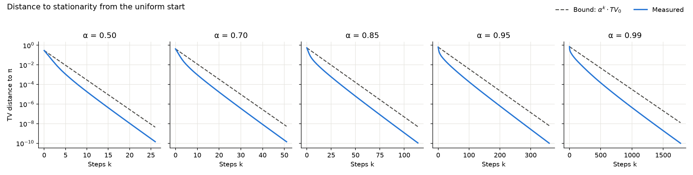
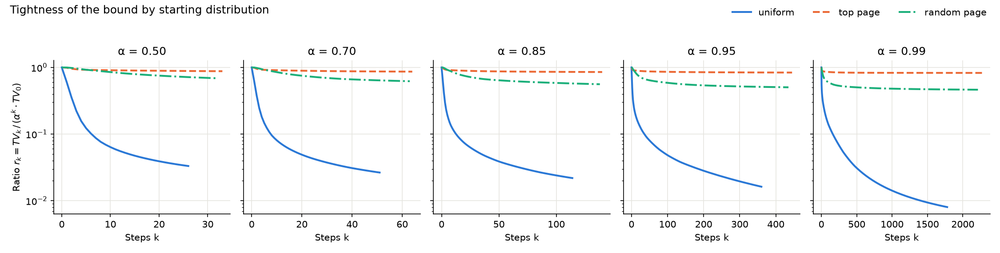

# How fast does the PageRank random surfer mix?

Old project from 2024: I thought I'd finally clean it up and do a writeup to throw onto Github! 

**Goal:** Measure how quickly the PageRank Markov chain converges to its stationary distribution on a real web graph, and compare that with the standard bound: after $`k`$ steps, the total variation distance is at most $`\alpha^k`$ times the starting distance, where $`\alpha`$ is the damping factor.

**Short answer:** The bound holds! On the Stanford web graph the long-run rate is exactly $`\alpha`$. How close the chain runs to the bound will depend on where it starts--- within a factor of 1.2 to 2.2 from a single page, and about 200 times better from the uniform distribution. We investigate the closed classes to understand this further.

The bound has a short direct proof, given below: each step shrinks the total variation distance by a factor of at least α, because the teleport term is the same for every starting distribution and cancels. The chain also satisfies Doeblin’s condition, which is the general reason chains like this converge geometrically. For the second eigenvalue of the PageRank matrix I rely on Haveliwala and Kamvar (2003).

## The chain

There are $`n`$ pages. With probability $`\alpha`$ the surfer follows a link chosen uniformly from the current page, and with probability $`1-\alpha`$ it jumps to a page chosen uniformly from the whole graph. Dangling pages are defined as per convention.

Let $`S`$ be the row-stochastic link matrix, with the row of each dangling page replaced by the uniform distribution $`u`$. The transition matrix is then:

```math
G = \alpha S + (1-\alpha)\,\mathbf{1}u
```

where $`\mathbf{1}`$ is a column of ones and $`u`$ is a row vector. Distributions are row vectors, so one step takes $`\mu`$ to $`\mu G`$. The stationary distribution $`\pi`$ satisfies $`\pi = \pi G`$, and it is the PageRank vector.

Total variation distance is half the L1 distance:

```math
\lVert \mu - \nu \rVert_{TV} = \tfrac{1}{2}\sum_{j} \lvert \mu(j) - \nu(j) \rvert
```

## The bound

**Proposition:** For every distribution $`\mu`$ and every $`k \ge 0`$,

```math
\lVert \mu G^{k} - \pi \rVert_{TV} \;\le\; \alpha^{k}\,\lVert \mu - \pi \rVert_{TV}
```

**Proof:** Let $`\mu`$ and $`\nu`$ be distributions. Their difference sums to zero, so $`(\mu-\nu)\mathbf{1} = 0`$ and the teleport term cancel to give us:

```math
(\mu-\nu)G = \alpha(\mu-\nu)S
```

The vector $`(\mu-\nu)S`$ also sums to zero, because $`S`$ is stochastic, so the step can be repeated. Taking $`\nu = \pi`$ and using $`\pi G = \pi`$ gives

```math
\mu G^{k} - \pi = \alpha^{k}(\mu-\pi)S^{k}
```

A stochastic matrix does not increase the L1 norm of a row vector, since $`\sum_j \lvert \sum_i v_i S_{ij} \rvert \le \sum_i \lvert v_i \rvert \sum_j S_{ij} = \sum_i \lvert v_i \rvert`$. Hence $`\lVert (\mu-\pi)S^{k} \rVert_{TV} \le \lVert \mu-\pi \rVert_{TV}`$, which proves the bound.

**Remarks**

- **Why α^k:** A surfer forgets where it started the first time it teleports. The chance of not having teleported in $`k`$ steps is $`\alpha^k`$, and that is the only part of the starting distribution's influence that can survive.
- **Doeblin's condition:** Every row of $`G`$ is at least $`(1-\alpha)u`$. Chains with this property always converge geometrically.
- **Uniqueness:** If $`\pi`$ and $`\pi'`$ are both stationary, the bound with $`k = 1`$ gives $`\lVert \pi-\pi' \rVert_{TV} \le \alpha \lVert \pi-\pi' \rVert_{TV}`$, so they are equal.

**The ratio:** The experiments measure

```math
r_k = \frac{\lVert \mu G^{k}-\pi \rVert_{TV}}{\alpha^{k}\,\lVert \mu-\pi \rVert_{TV}}
    = \frac{\lVert (\mu-\pi)S^{k} \rVert_{TV}}{\lVert \mu-\pi \rVert_{TV}}
```

It lies between 0 and 1 and cannot increase with $`k`$. If it levels off at a value $`c > 0`$, the distance behaves like $`c\,\alpha^{k}`$ times the starting distance: the rate is $`\alpha`$, and $`c`$ measures how far below the bound the chain runs. The second expression shows that $`r_k`$ can be computed from a surfer that never teleports.

## Data

- **Source:** [SNAP web-Stanford](https://snap.stanford.edu/data/web-Stanford.html), the link graph of stanford.edu collected in 2002.
- **Size:** 281,903 pages and 2,312,497 links (no duplicate links or no self-loops)
- **Dangling pages:** 172
- **Pages with no in-links:** 20,315 pages can be reached only by teleporting
- **Degrees:** The mean out-degree is 8.2. The largest in-degree is 38,606. The largest out-degree is exactly 255, which is definitely a cap on the original crawl (think powers of 2 minus 1)

## Method

- **Chain:** One step is compted with a sparse matrix product, without forming $`G`$. The implementation is then tested against `networkx.pagerank` on random graphs with dangling pages.
- **Reference distribution:** For each $`\alpha`$ in {0.50, 0.70, 0.85, 0.95, 0.99}, the chain is run from uniform until $`\alpha^k < 10^{-15}`$, which takes 50, 97, 213, 674 and 3,437 steps. One further step changes the result by at most $`2 \times 10^{-15}`$ in L1.
- **Chosen Starts:** The uniform distribution, a point mass on the top-ranked page, and a point mass on one page drawn at random with a fixed seed.
- **Measurement:** The distance to $`\pi`$ is recorded at every step down to $`10^{-10}`$.

## Results

### 1. The bound

In all 15 runs (five values of $`\alpha`$, three starts), the distance never exceeds $`\alpha^k`$ times the starting distance, and the ratio $`r_k`$ never rises.



### 2. The rate is close to α



On a log scale, convergence at rate $`\alpha`$ is a straight line with slope $`\ln\alpha`$. The table gives the slope fitted to the second half of each run, divided by $`\ln\alpha`$.

| α | Top page | Random page | Uniform |
| --- | --- | --- | --- |
| 0.50 | 1.0017 | 1.0118 | 1.0498 |
| 0.70 | 1.0015 | 1.0087 | 1.0487 |
| 0.85 | 1.0012 | 1.0081 | 1.0519 |
| 0.95 | 1.0009 | 1.0051 | 1.0685 |
| 0.99 | 1.0002 | 1.0026 | 1.0760 |

- **Top page:** the slope matches $`\ln\alpha`$ to within 0.2%, ad $`r_k`$ ends between 0.83 and 0.88.
- **Random page:** the slope is within 1.2% of $`\ln\alpha`$, ad $`r_k`$ ends between 0.46 and 0.69.
- **Uniform start:** the slope is 5% to 8% steeper than $`\ln\alpha`$, ad $`r_k`$ ends between 0.008 and 0.033 (still falling when the measurement reaches $`10^{-10}`$)

### 3. The bound overestimates the steps needed

Steps needed to come within $`10^{-6}`$ of $`\pi`$ from the uniform start:

| α | Measured | Guaranteed by the bound |
| --- | --- | --- |
| 0.50 | 14 | 19 |
| 0.70 | 28 | 37 |
| 0.85 | 61 | 82 |
| 0.95 | 193 | 262 |
| 0.99 | 928 | 1,343 |

The measured count is 69% to 76% of the bound's. The bound tends to overestimate by about a third.

### 4. The ratio levels off

Running the chain without teleporting, with $`\pi`$ taken at $`\alpha = 0.85`$:

| Steps | Top page | Random page | Uniform |
| --- | --- | --- | --- |
| 10 | 0.906 | 0.849 | 0.117 |
| 100 | 0.859 | 0.585 | 0.0240 |
| 1,000 | 0.832 | 0.479 | 0.0060 |
| 10,000 | 0.827 | 0.452 | 0.0048 |

The long-run rate is exactly $`\alpha`$. The constant is 0.83, 0.45 and 0.0048 respectively. 

At 100 steps these values agree to six digits with the ratios measured with teleporting switched on, gives us a numeric representation of the identity that gave us the bound.

### 5. Closed classes

A closed class is a set of pages that link among themselves and never link out.

- **Count:** The graph has 29,914 strongly connected components. Of these, 2,231 are closed, holding 85,261 pages. The largest has 4,888 pages, and 370 are pairs of pages.
- **Theory:** Haveliwala and Kamvar (2003) show that with two or more closed classes the second eigenvalue of $`G`$ has modulus exactly $`\alpha`$.
- **Rank collects in them:** Closed classes hold 31% of $`\pi`$ at $`\alpha = 0.50`$, 34% at 0.85, and 52% at 0.99.

Where each link-only surfer's mass is after 10,000 steps:

| Start | Mass in closed classes | Largest class share | Classes holding 90% of that mass |
| --- | --- | --- | --- |
| Top page | 99.9% | 35.9% | 4 |
| Random page | 98.1% | 6.4% | 162 |
| Uniform | 95.1% | 5.3% | 754 |
| π | 95.1% | 5.3% | 754 |

After many steps of following links, almost all of each surfer's probability is
stuck inside closed classes. The surfer started on the top page ends up in very
few of them: four classes hold 90% of its probability, and one holds 36%. A
surfer started from $`\pi`$ ends up spread over hundreds, with no class holding
more than 5.3%.

The two distributions put their probability in mostly different places, so the
distance between them stays at 0.83 of its starting value. Following links never
brings them together, since only teleporting does, which explains why the chain started fromthe top page converges almost as slowly as the bound allows.

### 6. The uniform start's remainder comes from periodic classes

Rearranging $`\pi = \alpha\pi S + (1-\alpha)u`$ gives

```math
\pi = (1-\alpha)\sum_{j \ge 0} \alpha^{j}\, u S^{j}
```

so $`\pi`$ is a weighted average of the uniform start's link-only path, and both bring the same mass into every closed class. The table above shows this. 

- **Locations:** 99.9% of the uniform start's remaining distance is inside closed classes, and 13% of it is inside two-page classes.
- **Averaging:** Averaging both surfers over 2,520 consecutive steps reduces the ratio from 0.0048 to 0.000005.

The remainder is a disagreement in phase inside periodic classes. The two surfers agree on how much mass each class holds and disagree on where in its cycle that mass is. If every closed class were aperiodic, the uniform start would converge faster than rate $`\alpha`$.

## Limitations

- **One graph.** The data is a single university's web graph from 2002. The constants are properties of this graph.
- **Two single-page starts.** One is the top-ranked page and one is a single random draw. They are not estimates for a typical page.
- **Uniform teleporting only.** Personalised teleport distributions are not studied.
- **Closed-class analysis at one α.** The long-run ratios use $`\pi`$ at $`\alpha = 0.85`$.
- **Periods are not computed.** Periodicity is inferred from the effect of averaging, and the period of each class is not calculated.

## How to run

```bash
python3 -m venv .venv
source .venv/bin/activate
pip install -r requirements.txt
curl -L -o data/web-Stanford.txt.gz https://snap.stanford.edu/data/web-Stanford.txt.gz
python -m pytest -q
```

Then run the notebooks in order.

## References

- L. Page, S. Brin, R. Motwani and T. Winograd. *The PageRank Citation Ranking: Bringing Order to the Web.* Stanford InfoLab technical report, 1999.
- T. H. Haveliwala and S. D. Kamvar. *The Second Eigenvalue of the Google Matrix.* Stanford University technical report, 2003.
- R. Nussbaum. *Notes on the Second Eigenvalue of the Google Matrix.* [arXiv:math/0307056](https://arxiv.org/abs/math/0307056), 2003.
- D. A. Levin, Y. Peres and E. L. Wilmer. *Markov Chains and Mixing Times.* American Mathematical Society.
- J. Leskovec and A. Krevl. *SNAP Datasets: Stanford Large Network Dataset Collection.* [snap.stanford.edu/data](https://snap.stanford.edu/data), 2014.
